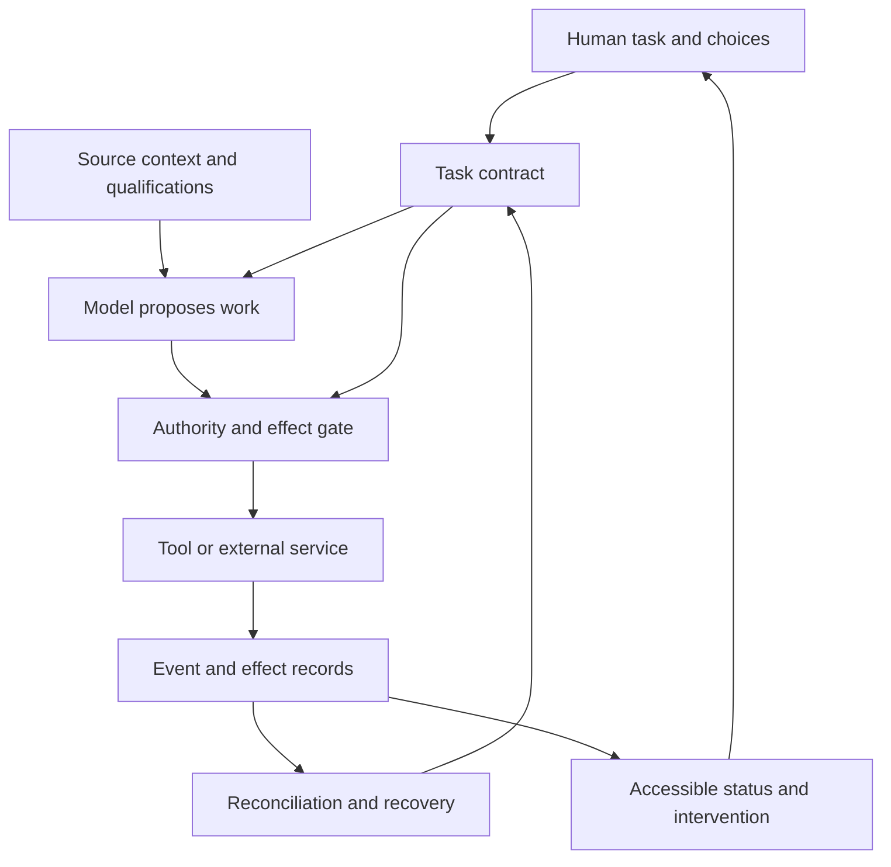

# Execution & Architectural Compatibility

Informative implementation guidance · LGIRS-2.1–2.5 and LGIRS-4.3–4.5

Reliable execution requires more than well-formed tool calls. The system must know the intended effect, the authority to attempt it, the observed outcome and how partial or uncertain effects will be handled.

## Capability, Intent, State

| Record | Contents | Boundary |
| --- | --- | --- |
| Capability | Operation name/version, inputs/outputs, side effects, supported errors, permissions and constraints | A description is not authorisation or proof the implementation behaves correctly |
| Intent | The actual task goal, material parameters, limits and relevant human decision | A model-generated plan is not an approval record |
| State | Event-derived execution status, effect status, outstanding dependencies and evidence | A predicted success narrative is not a receipt |

MCP and OpenAPI can support integration descriptions. They are different specifications and do not provide one universal Capability/Intent/State object. An adapter or orchestrator may supply parts of this contract; identify the boundary. Pin the supported versions and test actual semantics, not merely whether a response parses.

## Separate proposal from commitment

Use an enforcement boundary outside generated instructions. Before a side effect, check effective identity, permissions, task scope, recipient, resource/spending limits and any required approval. Carry the constraints to sub-agents and queued work. Recheck after revocation or material changes; a stale capability badge is insufficient.

An existing clear delegation can authorise low-impact work. Do not demand repeated confirmation simply because an agent is involved. For a new or materially changed high-impact or irreversible action, provide the appropriate preview and obtain the decision required by the actual policy and authority. Bind the decision to the relevant parameters and version; a yes to one action is not permission for another.

## A possible architecture

This diagram is a design pattern, not deployed software. A gate can be implemented in different ways; its checks must remain effective when the model or retrieved text changes. The event record and user status need a defined relationship.

## Treat remote uncertainty as a state

An HTTP timeout does not tell the client whether a remote operation committed. Record Outcome unknown when that is the truth. Use an operation identifier, the provider's actual lookup/idempotency support and reconciliation before retrying a potentially duplicating effect. If the provider offers none of these, the supported workflow and manual recovery must reflect that limitation.

Stopping also has stages: requested, acknowledged, new work halted and outstanding effects reconciled. A cancellation notification can arrive after completion or target work that cannot be cancelled. Prevent further scheduling where possible, propagate intent to dependent actors and handle late replies without erasing real effects. Define a response tolerance suitable to the service rather than promising instantaneous universal stopping.

See the [illustrative operation records](../examples/records/README.md). They are local example records, not MCP messages or production execution evidence.

## Recovery is not one universal Undo

| Action class | Possible approach | What to disclose |
| --- | --- | --- |
| Reversible within a real transaction | Roll back within the supported boundary | Transaction limits and whether commit already occurred |
| Reversible versioned write | Compare-and-restore the affected version | Concurrency conflicts and later legitimate edits |
| Compensatable external effect | A separately authorised correcting action | What remains, including disclosure, fees or downstream reliance |
| Irreversible effect | Prevention, appropriate pre-commit control and remedy | That no complete reversal is available |

A database checkpoint does not retract a delivered email. Compensation is not erasure. Do not overwrite another person's valid work while restoring an earlier state. A deterministic fallback can also be unsafe or inappropriate: use a fallback evaluated for the defined conditions, or stop/escalate with truthful state.

## Portability and change assurance

Keep durable state, permission enforcement and business invariants independent of model-specific prompt assumptions where appropriate. Common interfaces reduce some coupling, but model/provider changes can alter interpretation, tool choices, output quality and supervision burden.

Before affected release, run the versioned task, attack, recovery, accessibility and human-oversight scenarios on the actual candidate combination. Compare material failures and human effort, not only aggregate accuracy or schema validity. Record unsupported combinations, rollback/alternative plans and the human authority for release. See [EX08](../examples/ex08.md).

A reference implementation is evidence only for its evaluated scope and version. This documentation provides approaches and example records, not a production transaction engine, credential manager or guarantee of cross-provider equivalence.
